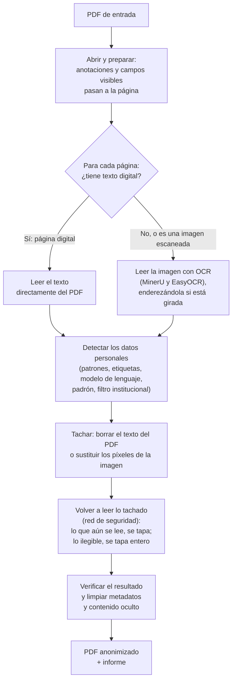

# Memoria del anonimizador de documentos

Qué hace el anonimizador, cómo lo hace y cómo sabemos que funciona. Está escrita para quien no ha
seguido el proyecto. El detalle para mantener el código está en la
[referencia técnica](referencia_tecnica.md), y los pasos para instalarlo y desplegarlo, en el
[README](../README.md).

---

## Índice

1. [Qué es el proyecto](#1-qué-es-el-proyecto)
2. [Qué datos anonimiza](#2-qué-datos-anonimiza)
3. [Cómo se detectan los datos](#3-cómo-se-detectan-los-datos)
4. [Cómo se anonimiza un documento](#4-cómo-se-anonimiza-un-documento)
5. [Metadatos](#5-metadatos)
6. [Privacidad del propio servicio](#6-privacidad-del-propio-servicio)
7. [Interfaz y API](#7-interfaz-y-api)
8. [Evaluación](#8-evaluación)
9. [Métricas](#9-métricas)
10. [Despliegue](#10-despliegue)
11. [Limitaciones conocidas](#11-limitaciones-conocidas)

---

## 1. Qué es el proyecto

El Ajuntament de València tiene que publicar o entregar a terceros documentos administrativos
—resoluciones, notificaciones, contratos, nóminas, expedientes enteros— sin los datos personales
de quienes aparecen en ellos. Hacerlo a mano es lento y es fácil que se escape algo.

El anonimizador, desarrollado por la Universitat de València (IDAL) para el Ajuntament, es un
servicio que recibe un PDF, encuentra los datos personales (nombres, DNI, direcciones, teléfonos,
cuentas bancarias…) y devuelve el mismo documento con esos datos **eliminados de verdad**, junto
con un informe de lo que ha hecho y de lo que conviene revisar a mano. Trabaja en castellano y en valenciano, con documentos digitales, escaneados o mezcla de
ambos, desde una página hasta expedientes de cientos. Funciona en un servidor propio, sin enviar
nada a internet.

---

## 2. Qué datos anonimiza

Unos treinta tipos de dato, agrupados como los ve el usuario en la pantalla:

| Grupo | Qué incluye | Ejemplo |
|---|---|---|
| Datos personales | Nombre, DNI, NIE, Seguridad Social, pasaporte, tarjeta sanitaria, lugar de nacimiento | «Marta Ferrer Soler», «48291736K» |
| Datos bancarios y económicos | Cuenta bancaria, tarjeta, importes, presupuestos de obra, póliza | «ES91 2100 0418 4502 0005 1332» |
| Contacto y dirección | Domicilio, código postal, teléfono, correo, referencia catastral | «C/ de Cuba 14, 3º B, 46006 València» |
| Empresas y documentos | Empresa privada, CIF, número de expediente y de registro, código de verificación, matrícula, códigos QR y de barras | «Registre d'entrada: 2023/045812» |
| Fechas | Fecha de nacimiento y cualquier otra fecha | «nacida el 14/03/1981» |
| Datos técnicos | Dirección web, dirección IP, usuario | «192.168.10.4» |
| Filas de tabla | Filas enteras de tablas de interesados o de cargos | una fila «expediente – interesado» |

**Todo viene activado**, y el usuario puede desmarcar cualquier tipo antes de procesar un
documento (por ejemplo, dejar visibles las fechas). Lo que se deja sin tachar
queda escrito en el informe.

**Decisiones de criterio:**

- **Firmas**: la rúbrica (el garabato) se conserva; el nombre escrito junto a ella sí se tacha.
- **Número de colegiado**: nunca se tacha, por requisito del ayuntamiento.
- **Importes**: solo se tachan si van ligados a una persona o a una cuenta (una nómina, una
  transferencia). El presupuesto de un contrato público es un tipo aparte, activo por defecto, que
  se puede desmarcar cuando deba quedar a la vista.
- **Fechas**: se tachan todas, no solo la de nacimiento.
- **Instituciones públicas**: su nombre no se tacha, ni su teléfono o dirección en el membrete.
- **Número de expediente**: se tacha, en todos sus formatos, también el municipal
  («E-03001-2022-000074-00»). Si el usuario lo desmarca, no se tacha ninguno.
- **Pendiente de decisión del ayuntamiento**: **los cargos que firman** (hoy el nombre de un
  secretario o un rector se tacha como el de cualquiera).

La lista completa de tipos y sus reglas: [referencia técnica](referencia_tecnica.md#catálogo-de-tipos-y-reglas).

---

## 3. Cómo se detectan los datos

No hay una sola técnica: cada tipo de dato se encuentra mejor de una manera, y el anonimizador
combina varias. Lo que una no ve, lo ve otra.

- **Patrones con validación.** Muchos datos tienen una forma fija: un DNI son ocho cifras y una
  letra, un IBAN empieza por «ES» y lleva 22 cifras. Además, la letra del DNI y dos cifras del IBAN
  son un **dígito de control** calculado a partir del resto, así que se puede comprobar si el
  número es coherente. «48291736K» tiene la forma y la letra correcta: es un DNI. El dígito de
  control refuerza la detección, pero no la descarta: un DNI con una cifra mal leída sigue siendo
  un DNI.
- **Campos con etiqueta.** En formularios y fichas, la etiqueta dice qué es el valor: lo que sigue a
  «Nombre:», «Domicilio:» o «Teléfono:» es un nombre, una dirección o un teléfono. Funciona también
  en valenciano («Nom i cognoms:», «Domicili:»), con las etiquetas bilingües de los impresos de la
  Generalitat («COGNOMS / APELLIDOS») y con el valor en la línea de debajo.
- **Un modelo de lenguaje** que reconoce nombres de persona, de empresas y de lugares por el
  contexto de la frase («…comparece Pedro Albert Gil, vecino de…»), aunque no lleven etiqueta.
- **El padrón del INE.** Las listas oficiales de nombres, apellidos y municipios sirven para
  confirmar lo dudoso: si el modelo propone «Libre Designación» como nombre, no está en el padrón y
  se descarta; si propone «Pedro», sí. También comprueban que el código postal de una dirección
  corresponde a su municipio.
- **El filtro institucional.** Los documentos llevan los datos de contacto del propio ayuntamiento
  o de la entidad que los emite (teléfono de la centralita, dirección de la sede). No son datos
  personales y se dejan a la vista. El filtro los reconoce por estar en el membrete o el pie junto
  al nombre de la institución. Un dato con etiqueta de persona («Domicilio del interesado») nunca
  se aparta.
- **Tolerancia a los errores del OCR.** Al leer un escaneo, el programa confunde a veces letras y
  cifras: lee la «B» final de un DNI como un «8», o la «O» de un IBAN como un «0». Esas confusiones
  típicas se tienen en cuenta: «48291736 8» tras la etiqueta «DNI» se reconoce como DNI porque el
  8 se parece a la B que exige el control. También se unen los teléfonos y cuentas partidos en dos
  líneas.

Una vez detectado un dato, se tacha **en todas sus apariciones** del documento, también donde por
sí solo no se habría reconocido (el nombre del interesado repetido sin etiqueta en un párrafo).

Detalle de cada vía: [referencia técnica](referencia_tecnica.md#detección).

---

## 4. Cómo se anonimiza un documento

### El recorrido

Leído como texto: el PDF entra y se prepara; **cada página** se clasifica según tenga texto digital
o sea una imagen; las digitales se leen directamente y las escaneadas por OCR; en el texto leído se
detectan los datos; se tachan borrándolos de verdad; se vuelve a leer el resultado para tapar lo
que aún se vea; se verifica, se limpian los metadatos y sale el PDF con su informe.

### Tres tipos de documento, decididos página a página

- **Digital**: generado por ordenador (un Word guardado como PDF). El texto está dentro del fichero
  y se puede seleccionar. Se lee directamente, sin errores.
- **Escaneado**: una fotografía del papel. No tiene texto, solo imagen; hay que leerla con
  **OCR** (reconocimiento óptico de caracteres: un programa que «lee» la imagen y la convierte en
  texto).
- **Híbrido**: mezcla de los dos, que es lo habitual en un expediente real (un oficio digital con
  la copia escaneada de un DNI detrás).

La decisión se toma **página a página**: en un expediente híbrido, las páginas digitales conservan
su texto seleccionable y solo las escaneadas pasan por OCR. Si una página digital lleva una imagen
pegada (la foto de un DNI dentro de un oficio), la imagen se lee aparte.

### El OCR: dos motores

- **MinerU** es un modelo de inteligencia artificial que lee la página entera entendiendo su
  estructura: sigue el orden de lectura, distingue párrafos y tablas. Da un texto de calidad, sobre
  el que se buscan los datos.
- **EasyOCR** lee palabra por palabra y da la **posición exacta** de cada una en la imagen, que es lo
  que hace falta para saber dónde tachar.

Se usan los dos porque cada uno hace bien una parte: MinerU entiende mejor qué dice la página y
EasyOCR sabe mejor dónde está cada palabra. EasyOCR hace además la relectura de control y sustituye
a MinerU si no está disponible.

Las páginas escaneadas **giradas** (un folio escaneado de lado) se detectan porque el OCR devuelve
ruido; se prueban los otros giros y se elige el que da un texto con sentido.

### Eliminar el dato de verdad

Tachar no es pintar una barra negra encima. En un PDF, una barra pintada es un dibujo más, puesto
**sobre** el texto: el texto sigue debajo. Basta con seleccionarlo y copiarlo, o abrir el fichero
con otro programa, para recuperar el dato. Muchos casos de datos filtrados en documentos públicos
son exactamente eso.

Por eso el anonimizador **elimina** el dato:

- En una **página digital**, borra del fichero las letras que forman el dato. Donde estaba el texto
  queda un recuadro negro, pero debajo ya no hay nada que seleccionar ni copiar.
- En una **página escaneada**, sustituye los píxeles de la imagen donde estaba el dato por píxeles
  negros y reconstruye la página con esa imagen. El dato ya no existe en ninguna parte del fichero.

### Tratamientos especiales

- **Copias de DNI**: se tapan enteras. En una copia escaneada se intenta tapar solo la tarjeta, si
  el resto de la página se puede conservar.
- **Autoliquidaciones** (impresos de tasas e impuestos): se tapan enteras; llevan datos personales
  y fiscales por toda la página.
- **Planos de obra**: solo se analiza el cajetín (el recuadro con el promotor, el arquitecto y la
  fecha); el dibujo se deja intacto.
- **Imágenes pegadas** en una página con texto: se leen por separado; si son la copia de un
  documento de identidad se tapan enteras, si no, solo los datos que tengan.
- **Códigos QR y de barras**: se leen y se tapan (un QR suele llevar dentro datos del documento).

Detalle: [referencia técnica](referencia_tecnica.md#tratamientos-especiales).

### La red de seguridad y el verificador

Después de tachar, el anonimizador **vuelve a leer** el resultado. En las páginas escaneadas, si
algún dato sigue leyéndose (porque una barra quedó corta, por ejemplo), se tapa en ese momento: es
la **red de seguridad**. En el documento entero, un **verificador** repasa el texto que se puede
extraer, los metadatos y el propio fichero en busca de datos que hayan sobrevivido; si encuentra
algo, el informe pide revisión manual.

Y una regla de prudencia: **lo que no se puede leer no se entrega sin revisar**. Una página
escaneada que el OCR no consigue leer, o que tarda demasiado, se tapa entera en lugar de entregarse
tal cual. El informe lo dice, página por página.

Detalle: [referencia técnica](referencia_tecnica.md#red-de-seguridad-y-verificación).

---

## 5. Metadatos

Un PDF lleva más información que la que se ve en la página: el autor y el programa con que se creó,
fechas, comentarios con el nombre de quien los escribió, marcadores, ficheros adjuntos, versiones
anteriores del documento guardadas dentro, y, en las fotos, el modelo del móvil, la fecha y las
coordenadas GPS de donde se hizo.

El principio es que **en el PDF entregado no queda nada oculto ni interactivo**: todo lo que se ve
ha pasado por el análisis, y lo demás se elimina. Las notas visibles y los campos de formulario
rellenos se integran en la página antes del análisis, para que lo que lleven se tache como el
resto; los comentarios, adjuntos, marcadores, metadatos de las fotos y versiones anteriores se
eliminan. Las fotos que se conservan pierden sus metadatos sin perder calidad.

**Solo quitar metadatos** es un segundo modo, para cuando el contenido puede publicarse tal cual:
la misma limpieza, sin analizar ni tachar nada. Los comentarios se eliminan (no se integran,
porque nadie revisa lo que lleven), los campos de formulario pasan a la página y el texto que no
se ve (en blanco sobre blanco, invisible o bajo una imagen, como la capa de OCR de un escaneado)
se quita. La pantalla, el nombre de la descarga y el informe dicen que el contenido NO se ha
revisado. En los dos modos, si el documento llevaba firma digital, se avisa de que deja de ser
válida.

Se comprueba con dos herramientas independientes del anonimizador, **ExifTool** y **qpdf**, que
examinan el fichero entregado y dicen qué queda. Sobre documentos preparados a propósito con toda
esa carga, en los tres tipos de documento, no queda nada.

Detalle y lista completa: [referencia técnica](referencia_tecnica.md#metadatos-y-contenido-oculto).

---

## 6. Privacidad del propio servicio

El anonimizador maneja documentos con datos personales, así que también tiene que cuidar los
suyos:

- **El original se borra** en cuanto termina el proceso.
- **El resultado se guarda seis horas** para poder descargarlo y después se borra solo. Al
  arrancar, el servicio borra lo que hubiera quedado de una ejecución anterior.
- **El servidor no guarda el nombre del fichero** (suele llevar el del interesado), y el informe de
  un trabajo no incluye los datos encontrados, solo cuántos y de qué tipo.
- **Los registros no guardan datos personales**: no se escribe texto de los documentos, y un filtro
  tapa por si acaso cualquier DNI, teléfono, correo o cuenta.
- **No hay usuarios ni contraseñas**, por decisión del proyecto: el servicio está pensado para una
  red interna a la que solo llega quien debe usarlo, o para ponerle la autenticación delante en el
  servidor web del ayuntamiento. Por la misma razón no existe un listado de documentos: para
  descargar uno hay que conocer su identificador.

Detalle: [referencia técnica](referencia_tecnica.md#retención-registro-y-acceso).

---

## 7. Interfaz y API

**La página web** (en la dirección del servicio) permite:

- subir uno o varios documentos a la vez (hasta 10 por tanda, de hasta 200 MB y 300 páginas cada
  uno);
- elegir qué tipos de dato ocultar, por grupos o uno a uno, o solo quitar los metadatos;
- seguir el avance de cada documento página a página;
- **parar** un documento y quedarse con las páginas ya hechas, o **eliminarlo** sin descargar nada;
- descargar el resultado, un **informe en PDF** para leer y el informe técnico (JSON).

El informe en PDF está escrito para quien no sabe informática. Empieza por si hay que revisar algo
y qué; después cuántos datos de cada tipo se han ocultado, un mapa de páginas (con datos, sin
datos, a revisar, tachadas enteras) y en qué página está cada uno, las páginas tachadas enteras y
por qué, y los metadatos eliminados. **No lleva ningún valor** de los datos ocultados ni el nombre
del fichero: solo la fecha, el número de páginas y el identificador del trabajo, porque se
descarga y puede acabar en cualquier sitio.

La página no necesita internet y no guarda nada del documento en el navegador.

**La API** (interfaz para otros programas) ofrece lo mismo: subir un documento a una cola
(`POST /jobs`, con `?treatment=metadata_only` para solo quitar metadatos), consultar su estado
(`GET /jobs/{id}`), descargar el resultado, el informe técnico o el informe en PDF
(`GET /jobs/{id}/report.pdf`), pararlo o eliminarlo, consultar el catálogo de tipos
(`GET /entity-types`) y comprobar el estado del servicio (`GET /health/ready`). Su documentación
interactiva está en `/docs`.

Detalle: [interfaz](referencia_tecnica.md#interfaz-web) y [API](referencia_tecnica.md#api).

---

## 8. Evaluación

### Documentos de prueba

No se puede medir la calidad con documentos reales: habría que saber de antemano dónde está cada
dato personal, y no se pueden compartir. Por eso se usa un **corpus sintético**: documentos
administrativos generados por ordenador con datos inventados, de los que se sabe exactamente qué
datos llevan y dónde (la «verdad de referencia»).

Hay tres corpus, uno por tipo de documento: **400 digitales, 28 escaneados y 24 híbridos**. Se
miden por separado porque cada uno sigue un camino distinto y falla de manera distinta: si se
sumaran, los 400 digitales taparían lo que pasa en los escaneados, que son los difíciles.

### Qué se mide

- **Precisión**: de todo lo que el anonimizador tacha como dato personal, qué parte lo es de verdad.
  Baja cuando tacha de más.
- **Recall** (exhaustividad): de todos los datos personales que hay, qué parte encuentra. Baja
  cuando se le escapan datos.
- **F1**: un solo número que combina los dos; solo es alto si los dos lo son. Va de 0 a 1.

Se cuenta de dos maneras. **Por valor**: cada dato distinto de un documento cuenta una vez (un DNI
que aparece tres veces es un dato), porque una vez detectado se tachan todas sus apariciones. **Por
aparición**: cada vez que aparece; es más estricta.

### La lectura de barras: mirar el PDF entregado

Las cifras anteriores comparan la **lista** de datos que el anonimizador dice haber encontrado con
la lista de los que había. Pero que un dato esté en la lista no garantiza que haya quedado tapado:
una barra puede quedar corta o desplazada, o tapar el dato de al lado. Durante el proyecto pasó, y
las cifras no lo veían.

Por eso se añadió la **lectura de barras**: se abre cada PDF entregado, se intenta leer cada dato de
la verdad de referencia y se cuenta cuántos siguen legibles (**fugas**). Es la prueba de lo que de
verdad recibe quien abre el documento.

Detalle de cómo se cuenta y cómo se mide: [referencia técnica](referencia_tecnica.md#evaluación).

---

## 9. Métricas

Medición final (**c4**), 19 de octubre de 2026:

| Documentos | F1 por valor | Precisión | Recall | F1 por aparición |
|---|---|---|---|---|
| Digitales (400) | **0,950** | 0,917 | 0,986 | 0,947 |
| Escaneados (28) | **0,947** | 0,945 | 0,950 | 0,915 |
| Híbridos (24) | **0,934** | 0,942 | 0,927 | 0,903 |
| **Media** | **0,944** | | | 0,922 |

La media es **aritmética**: cada tipo de documento pesa lo mismo, por la razón de la sección
anterior.

Evolución de la media del F1 por valor, desde la primera medición, antes de las mejoras:

| Línea base | c1 | c2 | c3 | c4 |
|---|---|---|---|---|
| 0,839 | 0,913 | 0,937 | 0,944 | **0,944** |

El mayor salto fue el de los documentos híbridos, que al principio se trataban como digitales y
no se leían sus páginas escaneadas. c4 no buscaba subir la media sino cubrir casos que el corpus no
tenía (imágenes pegadas, formularios, páginas giradas, dos columnas), sin perder nada.

**Lectura de barras** (porcentaje de datos tapados en el PDF entregado):

| Documentos | Tapado | Fugas |
|---|---|---|
| Digitales (muestra de 100) | 99,1 % | 14 |
| Escaneados (28) | 99,0 % | 3 |
| Híbridos (24) | 98,7 % | 6 |

De las 23 fugas, **8 son datos personales de verdad**: domicilios de particulares escritos dentro
de una frase. Las demás son el domicilio social de la empresa o universidad empleadora (un contacto
institucional que los documentos de prueba marcan como personal), el nombre de un secretario que
firma un certificado y dos fechas de un certificado escaneado.

Además de los corpus, se comprueba que no queda ningún dato a la vista en una batería de 107
formatos reales de teléfonos y direcciones, sin tomar por dato ninguna de 23 trampas (importes,
números de expediente…), y en documentos construidos con lo más difícil (copias de DNI giradas,
con sellos, dentro de expedientes).

El informe de calidad completo, para quien no ha seguido el trabajo, está en
[`evaluation/informe_final.html`](../evaluation/informe_final.html).

---

## 10. Despliegue

El anonimizador se entrega como una **imagen Docker**: un paquete que lleva dentro el programa, sus
librerías y los modelos de inteligencia artificial, y que se arranca con una orden. **No necesita
internet**: no descarga nada al arrancar (se ha probado sin red). Usa una tarjeta gráfica (GPU) de
NVIDIA del servidor, elegida por configuración; sin ella funciona, pero los escaneados no son
viables. Viaja como un fichero de unos 6,6 GB con su huella para comprobar que llega entero.

Los pasos para instalarlo y configurarlo están en el [README](../README.md#despliegue-con-docker);
las decisiones técnicas del despliegue, en la [referencia técnica](referencia_tecnica.md#despliegue).

---

## 11. Limitaciones conocidas

- **Domicilios dentro de una frase.** Un domicilio escrito en mitad de un párrafo («domiciliado en
  Ctra. de España, 60, Entresuelo Centro, 08002 Barcelona») puede quedar sin detectar, con su
  código postal. Son las únicas fugas de datos personales de verdad en la medición final (8 de 23).
- **Documentos de prueba sintéticos.** Las cifras se han medido sobre documentos generados; con
  expedientes reales, sobre todo escaneados de mala calidad, pueden ser peores.
- **Tipos sin medir.** Algunos tipos se detectan pero no aparecen en los documentos de prueba, así
  que su calidad no está medida: referencia catastral, filas de tabla, número de serie de
  certificado, tarjeta de crédito, tarjeta sanitaria, póliza, número de registro y usuario.
- **Cargos que firman, pendiente de decisión.** Hoy se tachan como cualquier nombre. Si se decide
  dejarlos visibles, tendrá que ser con una regla que distinga cargo de particular, no por la
  posición en la página.
- **Lugar de nacimiento.** Solo se reconoce cuando va tras su etiqueta («Lugar de nacimiento:»).
- **Rótulos tachados de más.** Cuando un rótulo sin dos puntos va seguido del dato en la línea de
  debajo («NIF / DNI del titular» y el número debajo), puede tacharse también parte del rótulo. Se
  pierde texto que no es personal, no se filtra nada.
- **Varios nombres seguidos en una fila**, separados por un solo espacio: solo se detecta el último.
- **Membrete de documentos escaneados.** El teléfono de la centralita puede salir tachado aunque es
  institucional, y un código postal compartido por el destinatario y la institución se tacha en los
  dos sitios.
- **Nombres dudosos.** El filtro con el padrón no se aplica a todos los nombres que propone el modelo
  de lenguaje: algunas frases institucionales o nombres de calle pueden tacharse como si fueran
  personas.
- **Marcas de agua.** En algunos documentos con marca de agua aparece un tachado grande que tapa
  contenido que no es personal.
- **Planos de obra.** Si no se encuentra el cajetín, la página se entrega intacta y se avisa para
  revisarla a mano. La fecha del cajetín puede leerse mal; falta comprobarlo con más planos reales.
- **Accesibilidad.** El PDF entregado pierde la estructura que usan los lectores de pantalla,
  porque esa estructura guarda copias del texto que sobrevivirían al tachado. Es una decisión de
  seguridad con un coste: la normativa de accesibilidad también se aplica a los PDF que el
  ayuntamiento publique en su web. Queda pendiente valorar si se puede conservar la estructura
  vaciando solo esas copias.
- **Metadatos que no se limpian.** Las imágenes en formatos poco habituales (JPEG 2000) o
  incrustadas de forma poco común conservan sus metadatos; no se han visto en ningún documento de
  prueba. El perfil de color de una foto se conserva y puede nombrar el modelo del dispositivo.
- **Sin GPU.** El servicio arranca, pero cada página escaneada tarda más que el tiempo máximo de
  lectura y sale tapada entera.
- **Velocidad.** Una página escaneada girada tarda unos 20 segundos más; un expediente escaneado de
  cientos de páginas lleva horas.
- **Sin usuarios ni contraseñas, y trabajos en memoria.** La protección depende de la red; si el
  servicio se reinicia, los documentos que estaban en cola o en proceso se pierden y hay que volver
  a subirlos.
